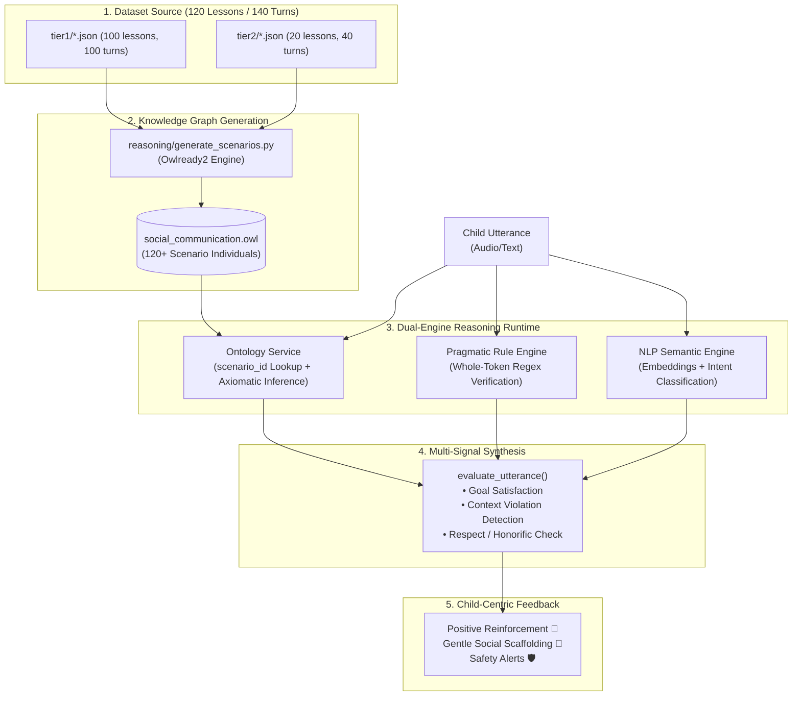

# TalkWise Social Communication Dataset (`DATASET.md`)

## 1. Overview & Clinical Grounding

The **TalkWise Social Communication Dataset** is a bilingual (Tamil & Tanglish) social-pragmatic dialogue training corpus engineered specifically for autistic children and speech-language therapy.

Standard language models and generic conversational datasets evaluate interactions purely on syntactic fluency or statistical likelihood. In contrast, autistic children frequently struggle with **context-sensitive pragmatic rules**, such as:
- Using appropriate honorifics with authority figures (Teacher, Parents, Elders).
- Setting polite boundaries and negotiating buffers rather than shutting down.
- Cooperative turn-taking and empathy with peers.
- **Safety refusals** with strangers (e.g., rejecting candy, lures, or rides while invoking a trusted adult), while distinguishing non-threatening interactions (e.g., giving street directions).

The dataset draws curriculum foundations from **Carol Gray’s Social Stories™** and evidence-based ASD behavioral communication interventions.

---

## 2. Dataset Architecture & Composition

The dataset comprises **120 curriculum lessons** (140 conversation turns) partitioned into two progressive learning tiers:

```
lessons/
├── tier1/                  # 100 Foundational Single-Turn Lessons (100 turns)
│   ├── father/             # 25 Lessons (Chores, Meal routines, Routines, Respect)
│   ├── teacher/            # 25 Lessons (Classroom decorum, Permission, Tasks)
│   ├── friend/             # 25 Lessons (Playground, Sharing, Empathy, Turn-taking)
│   └── stranger/           # 25 Lessons (Directions, Assistance, Safety Refusals)
└── tier2/                  # 20 Multi-Turn Interactive Milestone Lessons (40 turns)
    ├── father/             # 5 Lessons (Transitions, Polite Interruption, Helping, Routines)
    ├── teacher/            # 5 Lessons (Restroom permission, Doubts, Apologies, Breaks)
    ├── friend/             # 5 Lessons (Joining games, Empathy, Compliments, Sportsmanship)
    └── stranger/           # 5 Lessons (Lure Refusal, Safe Adult, Boundary Intrusion)
```

### Tier Summary Table

| Interlocutor | Tier 1 Lessons | Tier 2 Lessons | Total Scenarios | Total Turns | Primary Pragmatic Target |
| :--- | :---: | :---: | :---: | :---: | :--- |
| **Father / Parent** | 25 | 5 | 30 | 35 | Respectful agreement, Meal status reporting, Polite interruption, Transition negotiation |
| **Teacher** | 25 | 5 | 30 | 35 | Formal honorifics (`teacher`, `miss`, `sir`), Clarification requests, Permission seeking |
| **Friend / Peer** | 25 | 5 | 30 | 35 | Turn-taking (`va da`, `serndhu`), Sharing, Empathetic perspective-taking, Sportsmanship |
| **Stranger** | 25 | 5 | 30 | 35 | Differentiating general assistance (Directions, Time) from **Critical Safety Refusals** |
| **Total** | **100** | **20** | **120** | **140** | **Evidence-Based Social Scenarios** |

---

## 3. Schema Specifications

Both Tier 1 and Tier 2 run on the **Unified Single Graph Schema**. Every lesson possesses a `turns` array where each turn explicitly declares its ontological expectations and violations:

### Unified Turn Schema
```json
{
  "id": "t2_stranger_01",
  "character": "Stranger",
  "tier": 2,
  "difficulty": 3,
  "skill": "Stranger Lure Refusal & Seeking a Trusted Adult",
  "scenario": "A stranger approaches you at the park and offers you some candy.",
  "turns": [
    {
      "turn_id": "turn_1",
      "step_number": 1,
      "prompt": {
        "tanglish": "Thambi, indha chocolate vachiko. En kuda vandha innum tharen.",
        "tamil": "தம்பி, இந்த சாக்லேட் வச்சுக்கோ. என் கூட வந்தா இன்னும் தாரேன்."
      },
      "expected_intents": ["RefusalAndEscape"],
      "allowed_intents": ["PoliteRefusal"],
      "violates": ["StrangerCompliance", "SocialAcceptance"],
      "required_features": ["FirmNo", "MentionAdult"],
      "expected_responses": [
        "Venaam! Naan enga amma kitta poren",
        "No! Enaku venam. Appa kitta poren"
      ],
      "model_answer": "Venaam! Naan enga amma kitta poren",
      "nextTurn": "turn_2",
      "is_terminal": false
    },
    {
      "turn_id": "turn_2",
      "step_number": 2,
      "prompt": {
        "tanglish": "Paravala, onnum aagathu, vaa.",
        "tamil": "பரவால்ல, ஒன்னும் ஆகாது, வா."
      },
      "expected_intents": ["FirmRefusal"],
      "allowed_intents": ["SafetyRefusal"],
      "violates": ["StrangerCompliance", "SocialAcceptance"],
      "required_features": ["FirmNo"],
      "expected_responses": [
        "No! Naan vara maten!",
        "Venaam poidunga!"
      ],
      "model_answer": "No! Naan vara maten!",
      "nextTurn": null,
      "is_terminal": true
    }
  ]
}
```

*Note: For Tier 1 lessons, `turns` contains a single terminal turn (`nextTurn: null`, `is_terminal: true`), and top-level mirrored aliases (`question_tanglish`, `expected_answers`, `social_story`) are preserved for zero-breakage backwards compatibility.*

---

## 4. End-to-End Pipeline Diagram

The dataset is the **ground-truth source** for both the frontend interactive curriculum and the backend semantic knowledge graph.



---

## 5. Dataset Cleaning & Label Rectifications

During the Phase 2 Review 1 audit, critical semantic labeling anomalies were corrected:

1. **Stranger Interaction Disambiguation**:
   - **Previously**: All 25 Stranger lessons were unconditionally hardcoded to a single `Scenario_Stranger_Safety` archetype expecting `SafetyRefusal`.
   - **Bug Impact**: When a child answered directions politely (`stranger_01`: *"Straight poonga sir"*) or accepted a courtesy thank-you (`stranger_03`: *"Paravala sir"*), the engine raised a critical safety violation!
   - **Fix**: Stranger scenarios are now separated into:
     - **Informational & Courtesy Scenarios** (`stranger_01`–`stranger_21`, `stranger_23`–`stranger_25`): Expect `AnswerQuestion`, `UncertaintyResponse`, or `SocialAcceptance`.
     - **Safety Lure Scenarios** (`stranger_22`, `t2_stranger_01`–`t2_stranger_04`): Expect `SafetyRefusal`, allowing `PoliteRefusal`, and strictly violating on `StrangerCompliance`.

2. **Regex Whole-Token Boundary Matching**:
   - Eliminates substring collision bugs where Tamil/Tanglish words like `poonga` or English `good` triggered stranger `"go"` alarms, and `know` falsely triggered `"no"`.

---

## 6. Regenerating Scenarios

Whenever dataset lessons are modified or added, re-run the generator to synchronize the ontology:

```bash
python reasoning/generate_scenarios.py
```
