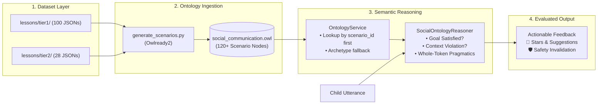

# TalkWise Social Pragmatic Ontology (`ONTOLOGY.md`)

## 1. Ontology Formalism & Overview

The **TalkWise Social Pragmatic Ontology** (`reasoning/social_communication.owl`) is an **OWL 2 DL (Description Logic)** knowledge graph designed to formalize social communication rules, interlocutor relationships, conversational expectations, and pragmatic boundaries for autistic children.

While neural models process surface semantics and embeddings, the **Ontology provides the normative standard**:
- It dictates **what a communicative turn means** in a given context.
- It specifies **what intent is expected** (e.g., `expectsIntent`).
- It defines **what communicative responses are strictly prohibited or unsafe** (e.g., `violatesScenario`, `violates`).
- It enforces **required linguistic and pragmatic features** (e.g., `requiresFeature`).

---

## 2. Core Taxonomy

```mermaid
classDiagram
    class Thing
    class SocialRole {
        <<Class>>
    }
    class Teacher
    class Parent
    class Peer
    class Stranger

    class SocialContext {
        <<Class>>
    }
    class TeacherContext
    class ClassroomContext
    class ParentContext
    class MealContext
    class PeerContext
    class PlaygroundContext
    class StrangerContext

    class CommunicativeIntent {
        <<Class>>
    }
    class AnswerQuestion
    class TaskCompletionConfirmation
    class IncompleteTaskReport
    class PoliteRequest
    class PoliteInterruption
    class ContextualRequest
    class SafetyRefusal
    class UncertaintyResponse
    class PeerInvitationAcceptance
    class PoliteRefusal
    class CooperativeSuggestion
    class HonestApology
    class StrangerCompliance
    class HostileRefusal
    class DisrespectfulInformal

    class LinguisticFeature {
        <<Class>>
    }
    class HonorificMarker
    class RefusalMarker
    class TrustedAdultReference
    class ExcuseMeMarker
    class FirstPersonStateMarker
    class TimeExtensionMarker

    class CommunicationScenario {
        <<Class>>
        +hasSocialRole: SocialRole
        +inSocialContext: SocialContext
        +expectsIntent: CommunicativeIntent
        +allowsAlternativeIntent: CommunicativeIntent
        +violatesScenario: CommunicativeIntent
        +requiresFeature: LinguisticFeature
    }

    Thing <|-- SocialRole
    SocialRole <|-- Teacher
    SocialRole <|-- Parent
    SocialRole <|-- Peer
    SocialRole <|-- Stranger

    Thing <|-- SocialContext
    SocialContext <|-- TeacherContext
    TeacherContext <|-- ClassroomContext
    SocialContext <|-- ParentContext
    ParentContext <|-- MealContext
    SocialContext <|-- PeerContext
    PeerContext <|-- PlaygroundContext
    SocialContext <|-- StrangerContext

    Thing <|-- CommunicativeIntent
    CommunicativeIntent <|-- AnswerQuestion
    CommunicativeIntent <|-- TaskCompletionConfirmation
    CommunicativeIntent <|-- IncompleteTaskReport
    CommunicativeIntent <|-- PoliteRequest
    CommunicativeIntent <|-- PoliteInterruption
    CommunicativeIntent <|-- ContextualRequest
    CommunicativeIntent <|-- SafetyRefusal
    CommunicativeIntent <|-- UncertaintyResponse
    CommunicativeIntent <|-- PeerInvitationAcceptance
    CommunicativeIntent <|-- PoliteRefusal
    CommunicativeIntent <|-- CooperativeSuggestion
    CommunicativeIntent <|-- HonestApology
    CommunicativeIntent <|-- StrangerCompliance
    CommunicativeIntent <|-- HostileRefusal
    CommunicativeIntent <|-- DisrespectfulInformal

    Thing <|-- LinguisticFeature
    LinguisticFeature <|-- HonorificMarker
    LinguisticFeature <|-- RefusalMarker
    LinguisticFeature <|-- TrustedAdultReference
    LinguisticFeature <|-- ExcuseMeMarker
    LinguisticFeature <|-- FirstPersonStateMarker
    LinguisticFeature <|-- TimeExtensionMarker

    Thing <|-- CommunicationScenario
```



---

## 3. The Dataset-to-Ontology Individual Link

### The Previous Architecture Gap
In earlier iterations, all 128 lessons in the dataset mapped onto only **6 hardcoded archetype individuals** through a rigid `if/else` ladder:
- `Scenario_Father_Meals`
- `Scenario_Father_PoliteInterruption`
- `Scenario_Father_Chore`
- `Scenario_Stranger_Safety`
- `Scenario_Teacher_Greeting`
- `Scenario_Peer_Play`

This created a major disconnect: lesson-specific requirements (e.g., distinguishing a post-office direction inquiry from a candy lure) could not be resolved by the ontology.

### The Fix: Generative Scenario Individuals
With `reasoning/generate_scenarios.py`, each dataset lesson is compiled directly into an individual node inside `social_communication.owl`:

$$\text{Dataset Lesson } (id, role, context, goal) \xrightarrow{\text{generate\_scenarios.py}} \text{OWL Individual: } \text{Scenario\_}\{id\}$$

Each scenario individual explicitly asserts:
- `hasSocialRole`: Interlocutor role individual (`TeacherRoleInd`, `ParentRoleInd`, `PeerRoleInd`, `StrangerRoleInd`).
- `inSocialContext`: Environmental context (`ClassroomContextInd`, `MealContextInd`, `PlaygroundContextInd`, `StrangerContextInd`).
- `expectsIntent`: Target communicative intent required to satisfy the goal.
- `allowsAlternativeIntent`: Valid pragmatic alternatives (e.g., asking for time or expressing uncertainty).
- `violatesScenario`: Prohibited intents that trigger social decorum or safety flags.
- `requiresFeature`: Required pragmatic markers (`HonorificMarker`, `ExcuseMeMarker`, `TimeExtensionMarker`).

---

## 4. End-to-End Architectural Pipeline



---

## 5. Runtime Resolution Protocol (`OntologyService`)

When an utterance is evaluated, `OntologyService.resolve_scenario_individual()` executes a **two-stage priority resolution**:

```python
# 1. Primary Lookup: Direct scenario_id lookup from dataset-generated individuals
if scenario_id:
    # Resolves "stranger_01" -> Scenario_stranger_01
    # Resolves "father_02"   -> Scenario_father_02
    # Resolves "t2_father_01" -> Scenario_t2_father_01
    ind = getattr(self.onto, f"Scenario_{clean_id}", None)
    if ind:
        return ind

# 2. Fallback: Old archetype if/else (Only if scenario_id is unmapped or None)
if "stranger" in role_l:
    if "safety" in goal_l or "lure" in goal_l:
        return self.onto.search_one(iri="*Scenario_Stranger_Safety")
    return self.onto.search_one(iri="*Scenario_stranger_01")
```

---

## 6. Key Bug Fixes Implemented

1. **Stranger Interaction Disambiguation**:
   - `stranger_01` (Directions - Post Office): Expects `[intent_AnswerQuestion, intent_Uncertainty]`, violates `[intent_HostileRefusal, intent_DisrespectfulInformal]`.
   - `stranger_03` (Thank You Response): Expects `[intent_SocialAcceptance]`. Context-level override prevents false safety violations on courtesies.
   - `stranger_22` (Lure / Candy): Strictly expects `[intent_SafetyRefusal]`, violates `[intent_StrangerCompliance]`.

2. **Regex Whole-Token Boundary Matching**:
   - Replaced naive substring checks (`syn in normalized`) with regex word-boundary matching (`\b{token}\b`).
   - Prevents Tanglish `"poonga"` and English `"good"` from matching danger `"go"`.
   - Prevents `"know"` from falsely matching refusal `"no"`.
   - Prevents Tier 2 `"pa"` from matching inside `"panren"`, and `"5"` from matching inside `"15"`.

3. **`save_progress` Argument Order Alignment**:
   - Corrected argument order in `backend/app.py`:
     ```python
     save_progress(
         user_id=user_id,
         interaction_id=question_id,
         response=response,
         correct=matched,
         stars=stars,
         tier=tier
     )
     ```

---

## 7. OWL DL Axiomatization & Build-Time Reasoning

### 7.1 Formal Axioms Implemented
In `reasoning/generate_scenarios.py`, the ontology is enriched with formal OWL 2 DL axioms:
1. **Safety Refusal Specialization Hierarchy**:
   `RefusalAndEscape`, `FirmRefusal`, `EscapeDanger`, and `PrivacyProtection` are formalized as subclasses of `SafetyRefusal`.
2. **Pairwise Disjoint Intents (`AllDisjoint`)**:
   Top-level communicative intents (`SafetyRefusal`, `AnswerQuestion`, `TaskCompletionConfirmation`, `IncompleteTaskReport`, `PoliteRequest`, `PoliteInterruption`, `ContextualRequest`, `UncertaintyResponse`, `PeerInvitationAcceptance`, `PoliteRefusal`, `CooperativeSuggestion`, `HonestApology`, `StrangerCompliance`, `HostileRefusal`, `DisrespectfulInformal`, `RequestHelp`, `ExplainSituation`, `CallForHelp`) are declared mutually disjoint.
3. **Disjoint Object Properties**:
   `AllDisjoint([expectsIntent, violatesScenario])` ensures that any scenario that both expects and violates the same intent is detected as logically inconsistent.
4. **Defined Scenario Classes (`owl:equivalentClass`)**:
   - `SafetyCriticalScenario ≡ CommunicationScenario ⊓ (expectsIntent some SafetyRefusal)`
   - `TaskCompletionScenario ≡ CommunicationScenario ⊓ (expectsIntent some TaskCompletionConfirmation)`
   - `PoliteInterruptionScenario ≡ CommunicationScenario ⊓ (expectsIntent some PoliteInterruption)`
   - `AuthorityDecorumScenario ≡ CommunicationScenario ⊓ (requiresFeature some HonorificMarker)`
   - `PeerCooperationScenario ≡ CommunicationScenario ⊓ ((expectsIntent some PeerInvitationAcceptance) ⊔ (expectsIntent some CooperativeSuggestion))`

### 7.2 Build-Time DL Reasoner (`reasoning/run_reasoner.py`)
- Resolves the local Java executable path (`owlready2.JAVA_EXE`) on Windows and POSIX.
- Invokes the **HermiT OWL DL Reasoner** (`sync_reasoner_hermit`) over `social_communication.owl`.
- Traps `OwlReadyInconsistentOntologyError` to verify logical consistency.
- Materializes 45+ inferred class memberships and saves the materialized knowledge graph to `reasoning/social_communication_inferred.owl`.

### 7.3 Inferred Graph Runtime Querying (`reasoning/ontology_service.py`)
- At runtime, `OntologyService` operates in either `inferred` (default) or `legacy` mode via `ONTOLOGY_MODE`:
  - `is_safety_critical(scenario_id)`: Queries `default_world.sparql` for `rdf:type onto:SafetyCriticalScenario` (falling back to Python property access if SPARQL is unavailable).
  - `expected_intents(scenario_id)` & `violating_intents(scenario_id)`: Extracts expected and violating intents via SPARQL graph queries.
- **Zero Hardcoded Lesson IDs**: All hardcoded lists (`("stranger_22", "t2_stranger_01", ...)`) have been removed from `backend/app.py`, `backend/engines/rule_engine.py`, and `reasoning/reasoner.py` in favor of dynamic ontology queries.

---

## 8. Automated Test Suite (`tests/test_reasoning.py`)
The ontology reasoning pipeline is validated with 4 automated test gates:
- **Test (a)**: Build-time reasoner runs and successfully saves `social_communication_inferred.owl`.
- **Test (b)**: `Scenario_stranger_22` and Tier 2 stranger scenarios (`Scenario_t2_stranger_01`..`05`) are classified as `SafetyCriticalScenario` with zero false positives across all 114 other scenarios.
- **Test (c)**: A deliberately contradictory scenario (both expecting and violating the same intent) is caught as inconsistent by HermiT.
- **Test (d)**: Complete 120/120 concordance between `ONTOLOGY_MODE=legacy` and `ONTOLOGY_MODE=inferred`.
